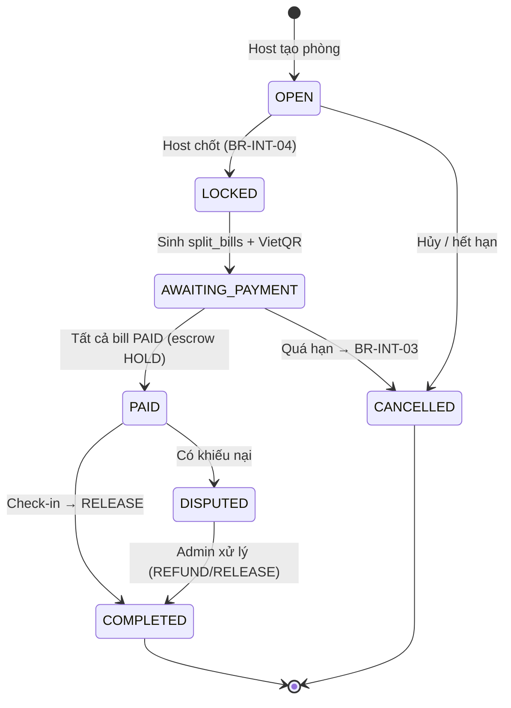

# PLAN — SyncHub (BookSlot + GroupOrder)

> Mô hình: **Solo Developer + 4 AI Agents** · Thời lượng: **6 Khối công việc, hạn nộp 20/11/2026** · Owner: **Đào Tiến Đạt**
> File này là kế hoạch triển khai. Nguồn sự thật về nghiệp vụ/CSDL là `CONTEXT.md` (tạo ở Khối 1, khóa trước khi code).

---

## 0. Mục tiêu & Deliverables nộp LMS

| # | Deliverable | Khối | Định dạng | Trạng thái hiện tại |
|---|---|---|---|---|
| D1 | Báo cáo đồ án (Ch.1 → Ch.6 + Bảng phân công) | 1 → 6 | `.docx`, `.pdf` | Đang thực hiện (Đã có `ch1.md` → `ch4-impl.md` + `test-cases.md`; chờ xuất Word/PDF) |
| D2 | Slide thuyết trình 12–15 trang | 6 | `.pptx` | Chờ hoàn thiện sau |
| D3 | Source code chạy được (client + server + seed) | 2 → 6 | `MaLopHocPhan_STTNhom.zip` | **Hoàn thành 100%** (Website Client + Server + Seed + `.env.example`, 65/65 tests Pass, `npm run build` sạch) |
| D4 | Bộ sơ đồ: Use Case, BPMN, Sequence, State Machine, ERD | 1 | `.png` + nguồn `.mmd`/`.drawio` | **Hoàn thành 100%** (5 bộ sơ đồ chuẩn `.svg`, `@2x .png`, `.mmd`, `.html`) |
| D5 | Bảng Test Case + ảnh chụp kết quả Pass | 6 | `docs/test-cases.md` + `postman/` | **Hoàn thành 100%** (30 Black-box TC + 65 Vitest tests Pass + Postman Collection + 9 ảnh chụp màn hình `docs/screenshots/`) |
| D6 | Kịch bản demo 10 phút + bộ câu hỏi vấn đáp | 6 | `docs/demo-script.md` | **Hoàn thành 100%** (Kịch bản 10 phút 2 thiết bị + 10 câu hỏi & đáp án vấn đáp) |

**Definition of Done toàn dự án:** chạy `npm run setup && npm run dev` trên máy sạch → seed xong → demo trọn luồng *Đặt sân → Mở phòng → Gọi nước chung → Chốt & chia bill → QR → Escrow → Check-in → Giải ngân* trên 2 thiết bị.

---

## 1. Quyết định kiến trúc (đã chốt)

| Hạng mục | Đề xuất | Lý do |
|---|---|---|
| Frontend | **React 18 + Vite + TypeScript + TailwindCSS** | AI agent sinh code React ổn định nhất; v0.dev xuất thẳng React/Tailwind |
| Design skill | **Hallmark** (`/hallmark` build/audit/redesign/study) + `design.md` | Giao diện có bản sắc, không "AI slop"; kiểm tự động bằng sloplint |
| State/Data | TanStack Query + Zustand | Cache API + state phòng realtime |
| Backend | **Node.js + Express + TypeScript** | Theo WBS |
| Realtime | **Socket.io** (room = `lobby:{id}`) | Giỏ hàng chung, chat, thông báo |
| Database | **PostgreSQL 16 + Prisma** | Transaction + row lock cho khóa slot; Enum; `Decimal`/`Int` cho tiền |
| Auth | JWT (access 15') + bcrypt, RBAC 4 role | `HOST`, `MEMBER`, `PROVIDER`, `ADMIN` |
| Map | **Leaflet + OpenStreetMap** | Miễn phí, không cần thẻ Visa |
| Chart | Recharts | Dashboard Provider/Admin |
| QR thanh toán | URL `https://img.vietqr.io/image/{BANK}-{ACC}-compact2.png?amount=&addInfo=` | QR thật, không cần tài khoản doanh nghiệp |
| QR mời phòng | `qrcode.react` | Sinh từ invite link |
| Upload ảnh khiếu nại | Multer → `server/uploads/` | Đủ cho demo |
| Test | Vitest + Supertest (API), Postman collection | Chứng minh BR bằng test |
| Hạ tầng dev | Docker Compose (Postgres) | 1 lệnh dựng DB |

> [!] **Tiền tệ:** lưu `Int` (VND, không có phần thập phân). Mọi phép chia dùng thuật toán làm tròn ở mục 5.3.

---

## 2. Cấu trúc repo

```
WebKD/
├─ plan.md                 # file này
├─ CONTEXT.md              # KHÓA: 12 bảng + 15 BR + 12 UC + API contract (AI phải đọc trước)
├─ design.md               # Design system do Hallmark sinh (font, màu, spacing, theme)
├─ .cursorrules / AGENTS.md# Quy tắc cho AI agent (trỏ tới CONTEXT.md + design.md)
├─ docker-compose.yml
├─ client/                 # React + Vite
│  └─ src/{pages,components,features/{auth,search,booking,lobby,cart,bill,escrow,dispute,admin},lib,socket}
├─ server/                 # Express + Prisma
│  ├─ prisma/{schema.prisma,seed.ts}
│  └─ src/{routes,controllers,services,sockets,middlewares,utils}
│     └─ services/{slotLock,splitBill,escrow,reputation,promo,recommend}.ts   # logic lõi, có unit test
├─ docs/
│  ├─ diagrams/            # .mmd + .png
│  ├─ report/              # bản nháp từng chương (.md) → ghép Word
│  ├─ test-cases.md
│  └─ demo-script.md
└─ postman/SyncHub.postman_collection.json
```

---

## 3. Đội ngũ & Quy trình điều phối

### 3.1 Vai trò

| Vai trò | Thực thi | Tỷ lệ AI/Bạn | Công cụ | Cổng duyệt của Bạn |
|---|---|---|---|---|
| Project Lead & PO | Bạn | 0/100 | — | Scope, duyệt ERD, kiểm luồng tiền, tích hợp, vấn đáp |
| Agent 1: BA & Architect | AI + Bạn | 70/30 | Claude/Gemini, Mermaid, Draw.io | Chốt BR-INT-02, BR-INT-03, Enum, kiểu tiền |
| Agent 2: UI/UX & FE | AI + Bạn | 80/20 | v0.dev/Stitch, Cursor/Claude Code | Số click "đặt sân → gọi nước" ≤ 3 |
| Agent 3: BE & Realtime | AI + Bạn | 75/25 | Cursor/Windsurf | Transaction khóa slot, chống double-release |
| Agent 4: QA, Seed & Docs | AI + Bạn | 85/15 | ChatGPT/Gemini, Postman | Tọa độ thật, test Pass, format báo cáo |

### 3.2 Vòng lặp mỗi WBS (Vertical Slice)

```
1. Bạn: mở issue WBS-x.y (mục tiêu, BR liên quan, DoD)
2. AI : đọc CONTEXT.md → đề xuất thiết kế ngắn (API/schema/event) → Bạn duyệt
3. AI : code 1 slice (BE service + test → route → FE màn hình)
4. Bạn: chạy test + thao tác tay theo "Cổng duyệt" → sửa/nhắc AI
5. AI4: cập nhật docs/test-cases.md + đoạn báo cáo tương ứng
6. Bạn: commit `feat(WBS-x.y): ...`, tick checklist bên dưới
```

### 3.3 Hallmark — skill thiết kế UI & Design System (Agent 2)

[Hallmark](https://www.usehallmark.com) (nutlope/hallmark, open-source): skill chống giao diện "AI slop" cho Claude Code/Cursor/Codex. Có catalog ~50 theme, quét dự án trước khi code, `sloplint` kiểm tra bằng headless browser nhiều độ rộng màn hình, và sub-agent review với context mới.

**Cài đặt (một lần):** `npx skills add nutlope/hallmark -g` (Node ≥ 18; cần Chrome + `puppeteer-core` để chạy sloplint).

| Lệnh | Dùng khi | Khối |
|---|---|---|
| `/hallmark study <url/ảnh>` | Lấy "DNA" thiết kế (font, màu, bố cục) từ 2–3 app tham chiếu: Grab Food, ShopeeFood, Playtomo/booking sân | 2 |
| `/hallmark <prompt>` | Tạo màn hình/component mới theo theme đã chọn | 2–5 |
| `/hallmark audit <file/trang>` | Chấm điểm UI theo checklist anti-pattern trước khi merge | 3–6 |
| `/hallmark redesign <file>` | Làm lại giao diện, **giữ nguyên** copy/logic/IA (dùng cho màn đã nối API/socket) | 4–6 |

**Quy trình Design System (WBS-2.0):**
1. `study` 2–3 tham chiếu → chọn **1 theme** trong catalog hợp với ứng dụng đặt sân + gọi đồ nhóm (thân thiện, tin cậy, thao tác nhanh trên mobile). *Bạn chốt theme.*
2. Hallmark sinh `design.md` ở gốc repo: font, bảng màu, spacing, radius, motion, nguyên tắc layout theo tác vụ.
3. Chuyển `design.md` thành `client/src/styles/tokens.css` + `tailwind.config` (màu ngữ nghĩa: `--status-open/locked/held/paid`, `--rep-A/B/C`).
4. Dựng bộ component nền (`Button, Card, Badge, Modal, Countdown, MemberAvatar, MoneyText, QRCard, CartRow, ChatBubble`) và trang `/styleguide` (cũng dùng làm ảnh cho báo cáo Ch.3).
5. Mọi màn mới đọc `design.md` trước, chỉ dùng token/component có sẵn.

**Cổng chất lượng UI (thêm vào DoD các WBS có giao diện):** `/hallmark audit` không còn lỗi mức cao + `sloplint` sạch ở 375 / 768 / 1280 px + bạn kiểm tay luồng chính trên điện thoại thật. Mockup Figma ở WBS-2.1 là tùy chọn nếu đã có prototype từ Hallmark.

> [!] Hallmark chỉ quyết định *giao diện*. Nghiệp vụ, tên cột, công thức tiền vẫn theo `CONTEXT.md`; đưa vào `.cursorrules`: *"UI đọc `design.md`; không đổi logic khi redesign."*

### 3.4 Prompt mẫu (dán đầu mỗi phiên)

```
Đọc CONTEXT.md trước. KHÔNG thêm/đổi tên bảng, cột, enum, BR ngoài file đó.
Nhiệm vụ: WBS-<mã> — <tên>. Phạm vi DUY NHẤT: <API/màn hình>.
Luật áp dụng: <BR-...>. Đầu ra: code + unit test cho service + danh sách file đã sửa.
Nếu thiếu thông tin trong CONTEXT.md → hỏi lại, không tự bịa.
```

---

## 4. Nội dung khóa trong `CONTEXT.md` (bản đề xuất — chốt ở WBS-1.2/1.4)

> [!] Nếu bản Briefing trước đã chốt 12 bảng/BR khác, **ưu tiên bản Briefing** và cập nhật lại mục này.

### 4.1 Mười hai bảng

| # | Bảng | Cột chính | Ghi chú/Index |
|---|---|---|---|
| 1 | `users` | id, email, password_hash, full_name, phone, role, reputation_score (100), status `ACTIVE/FLAGGED/BANNED` | unique(email) |
| 2 | `providers` | id, owner_id→users, type `VENUE/FNB`, category (badminton, study_room, milk_tea…), name, address, lat, lng, open_hours, bank_code, bank_account, commission_rate | index(type), index(lat,lng) |
| 3 | `slots` | id, provider_id, start_at, end_at, price, status `AVAILABLE/LOCKED/BOOKED`, locked_by, locked_until | **unique(provider_id,start_at)**, index(status,locked_until) |
| 4 | `menu_items` | id, provider_id(FNB), name, price, image_url, is_available, order_count | index(provider_id) |
| 5 | `group_lobbies` | id, host_id, slot_id, fnb_provider_id?, invite_code, status, deadline_at, ship_fee, voucher_id?, locked_at | unique(invite_code), unique(slot_id) |
| 6 | `lobby_members` | lobby_id, user_id, deposit_required, deposit_paid, status `JOINED/LEFT/NO_SHOW/CHECKED_IN` | PK(lobby_id,user_id) |
| 7 | `cart_items` | id, lobby_id, user_id, menu_item_id, qty, unit_price_snapshot | index(lobby_id) |
| 8 | `vouchers` | id, code, scope `VENUE/FNB/CROSS`, discount_type `PERCENT/FIXED`, value, max_discount, min_order, max_distance_m, valid_from/to, usage_limit, used_count | unique(code) |
| 9 | `split_bills` | id, lobby_id, user_id, slot_share, food_amount, ship_share, discount_share, deposit_offset, total, vietqr_url, status `PENDING/PAID/REFUNDED` | unique(lobby_id,user_id) |
| 10 | `escrow_transactions` | id, lobby_id, split_bill_id?, type `HOLD/RELEASE/REFUND/PENALTY`, amount, payee_provider_id?, status, **idempotency_key** | **unique(idempotency_key)** |
| 11 | `disputes` | id, lobby_id, reporter_id, target_provider_id, reason, evidence_urls[], status `OPEN/RESOLVED/REJECTED`, refund_amount, resolved_by | index(status) |
| 12 | `audit_logs` | id, actor_id, action, entity, entity_id, before(json), after(json), created_at | index(entity,entity_id) |

*Mở rộng nếu cần (không tính vào 12):* `chat_messages`, `reputation_logs`. **Đề xuất giữ 12 bảng:** chat lưu tạm in-memory 50 tin/phòng; biến động điểm uy tín ghi vào `audit_logs` (action=`REPUTATION_CHANGE`).

### 4.2 Mười lăm luật nghiệp vụ

| Mã | Luật |
|---|---|
| BR-SLT-01 | Giữ chỗ tạm: `locked_until = now + 10'`, thực hiện trong transaction; hết hạn chưa thanh toán → tự trả về `AVAILABLE` |
| BR-SLT-02 | Một slot chỉ thuộc tối đa 1 booking/lobby (unique + điều kiện update nguyên tử) |
| BR-INT-01 | Lobby bắt buộc gắn 1 slot đã giữ; chỉ thêm món khi lobby `OPEN` |
| **BR-INT-02** | **Chia bill:** tiền sân chia đều cho thành viên `JOINED`; tiền món theo món cá nhân; phí ship & voucher FNB phân bổ theo tỷ lệ tiền món; voucher VENUE/CROSS trừ vào tiền sân chia đều; tổng các phần = tổng hóa đơn (chênh lệch làm tròn dồn theo mục 5.3) |
| **BR-INT-03** | **Hủy liên đới:** hủy slot → hủy toàn bộ đơn đồ ăn của lobby & hoàn tiền `HELD`; thành viên rời sau `LOCKED` vẫn chịu phần tiền sân (trừ vào cọc) |
| BR-INT-04 | Host khóa phòng (`LOCKED`) → mọi client bị vô hiệu thao tác giỏ hàng ngay lập tức (server từ chối + socket event) |
| BR-INT-05 | Voucher CROSS chỉ hợp lệ khi lobby có cả slot và đơn FNB, khoảng cách VENUE–FNB ≤ `max_distance_m` (mặc định 1 km) |
| BR-REP-01 | Điểm khởi tạo 100. Hạng: **A ≥ 90** không cọc · **B 70–89** cọc 30% phần sân · **C 50–69** cọc 100% phần sân · **< 50** `FLAGGED`, không được vào phòng |
| BR-REP-02 | Bùng kèo (no-show): −15 điểm, mất cọc (chuyển cho chủ sân qua `PENALTY`) |
| BR-REP-03 | Hoàn thành buổi (check-in): +2 điểm, tối đa 100 |
| BR-ESC-01 | Xác nhận chuyển khoản (webhook giả lập) → `split_bills.PAID` + `escrow HOLD` |
| BR-ESC-02 | Check-in → giải ngân: phần sân → VENUE, phần món → FNB, trừ hoa hồng `commission_rate` cho nền tảng |
| BR-ESC-03 | Mỗi lần giải ngân/hoàn tiền có `idempotency_key` duy nhất (`release:{lobby}:{provider}`) → không giải ngân 2 lần |
| BR-ESC-04 | Khiếu nại `OPEN` trước giải ngân → đóng băng phần tiền của provider bị khiếu nại đến khi Admin xử lý |
| BR-DSP-01 | Admin phân xử hoàn một phần/toàn phần từ Escrow; mọi thao tác ghi `audit_logs` |

### 4.3 Mười hai Use Case

| UC | Tên | Actor | BR |
|---|---|---|---|
| UC01 | Đăng ký / Đăng nhập / Xem hạng uy tín | All | REP-01 |
| UC02 | Tìm kiếm đa tiêu chí & bản đồ | Member | — |
| UC03 | Đặt & giữ slot | Host | SLT-01, SLT-02 |
| UC04 | Tạo phòng ghép kèo, mời bằng link/QR | Host | INT-01 |
| UC05 | Tham gia phòng (kiểm tra uy tín/cọc) | Member | REP-01 |
| UC06 | Giỏ hàng chung & chat realtime | Host, Member | INT-01, INT-04 |
| UC07 | Gợi ý quán/món & áp voucher chéo | Host | INT-05 |
| UC08 | Chốt phòng, chia bill, sinh VietQR | Host | INT-02 |
| UC09 | Thanh toán & giữ tiền Escrow | Member | ESC-01 |
| UC10 | Check-in & giải ngân đa bên | Host, Provider | ESC-02, ESC-03, REP-02, REP-03 |
| UC11 | Gửi & phân xử khiếu nại | Member, Admin | ESC-04, DSP-01, INT-03 |
| UC12 | Portal Provider & Admin Dashboard | Provider, Admin | DSP-01 |

---

## 5. Đặc tả kỹ thuật lõi (Agent 3 phải tuân theo)

### 5.1 Khóa slot chống trùng (BR-SLT-01/02)

Cập nhật nguyên tử trong 1 transaction — chỉ 1 request thắng:

```sql
UPDATE slots
SET status='LOCKED', locked_by=$user, locked_until=now()+interval '10 minutes'
WHERE id=$slot AND (status='AVAILABLE' OR (status='LOCKED' AND locked_until < now()))
RETURNING id;           -- 0 dòng → 409 SLOT_TAKEN
```
Job `setInterval` 60s trả slot hết hạn về `AVAILABLE` + emit `slot:released`.
**Test bắt buộc:** `Promise.all` 20 request đồng thời → đúng 1 thành công, 19 nhận 409.

### 5.2 Vòng đời



Escrow: `HOLD → RELEASED | REFUNDED | FROZEN → (RELEASED | REFUNDED)`; chuyển trạng thái chỉ qua `services/escrow.ts` bằng `UPDATE ... WHERE status='HELD'` + `idempotency_key`.

### 5.3 Thuật toán chia bill (BR-INT-02)

1. `slot_net = slot_price − venue_discount` → chia đều N người.
2. `food_i` = Σ(qty × unit_price_snapshot) của người i.
3. `adj = ship_fee − fnb_discount` → phân bổ `adj × food_i / Σfood` (nếu Σfood = 0 thì 0).
4. Mỗi phần tính bằng `Math.floor`, phần dư (VND) phân phối theo **Largest Remainder**; nếu vẫn hòa → dồn cho Host.
5. Assert: `Σ total_i === slot_net + Σfood + adj`. Sai → throw, không ghi DB.

**Ca kiểm tra tay (đưa vào báo cáo):** sân 120.000/4 người; món A 25k, B 30k, C 0, D 45k; ship 15k; voucher FNB −20k.

| | Sân | Món | Ship−Voucher | **Tổng** |
|---|---|---|---|---|
| A | 30.000 | 25.000 | −1.250 | **53.750** |
| B | 30.000 | 30.000 | −1.500 | **58.500** |
| C | 30.000 | 0 | 0 | **30.000** |
| D | 30.000 | 45.000 | −2.250 | **72.750** |
| Σ | 120.000 | 100.000 | −5.000 | **215.000** ✔ |

### 5.4 Socket.io events (room `lobby:{id}`)

| Client → Server | Server → Room |
|---|---|
| `lobby:join`, `lobby:leave` | `lobby:members` |
| `cart:add`, `cart:update`, `cart:remove` | `cart:updated` (toàn bộ giỏ + subtotal) |
| `chat:send` | `chat:message` |
| — | `lobby:locked`, `bill:ready`, `payment:confirmed`, `escrow:released`, `notify` |

Server là nguồn sự thật: mọi `cart:*` kiểm tra `lobby.status==='OPEN'` và quyền thành viên trước khi ghi DB.

### 5.5 Gợi ý thông minh (rule-based, giải thích được)

`score = 0.5·(1 − d/1000m) + 0.3·khớp_khung_giờ + 0.2·norm(order_count)` (+ bonus nếu có voucher CROSS). Món đi kèm: co-occurrence đếm từ `cart_items` lịch sử. UI hiển thị lý do: *"Cách sân 350 m · đang mở · có mã giảm 15% chéo"*.

---

## 6. Lộ trình 6 Khối công việc (checklist)

> **Hạn nộp: 20/11/2026.** Không chia theo ngày: làm tuần tự từng **Khối**, xong Khối này (đạt DoD) mới sang Khối sau, làm nhanh nhất có thể.
>
> 📊 **Bảng trạng thái tổng thể (Cập nhật 07/11/2026):**
> - **Tiến độ tổng:** **20 / 22 WBS tasks hoàn thành (90.9%) — Hoàn tất 100% phần Website & Kiểm thử**
> - **Khối đã xong:** **Khối 1** (Phân tích & Thiết kế), **Khối 2** (UI/UX & Base Project), **Khối 3** (BookSlot & Phòng ghép kèo), **Khối 4** (GroupOrder Realtime & Chia Bill), **Khối 5** (Escrow, Khiếu nại, Uy tín, Dashboard), **Khối 6 — Phần Website, Kiểm thử & Demo** (WBS-6.0, WBS-6.1, WBS-6.3).
> - **Test Suite:** **65 / 65 tests PASS** (`tests/seed-data.test.ts`, `tests/auth.test.ts`, `tests/bookslot.test.ts`, `tests/split-bill.test.ts`, `tests/grouporder.test.ts`, `tests/escrow.test.ts`, `tests/dispute-admin.test.ts`).
> - **Hạng mục chờ hoàn thiện sau:** **WBS-6.2** (Xuất báo cáo Word/PDF & Slide thuyết trình `.pptx`).

### Khối 1 — Phân tích & Thiết kế · *Báo cáo Ch.1–2*

- [x] **WBS-1.1** BMC, FR/NFR — *Bạn chốt:* tỷ lệ hoa hồng (đề xuất VENUE 8%, FNB 12%), ngưỡng cọc BR-REP-01, **Out-of-scope** (thanh toán thật, ship thật, app mobile native)
- [x] **WBS-1.2** Đặc tả 12 UC (Basic/Alt/Exception) + 15 BR — *Gate:* duyệt tay BR-INT-02 (ca 5.3) & BR-INT-03
- [x] **WBS-1.3** Mermaid/PlantUML: Use Case, BPMN (luồng tích hợp), Sequence (WebSocket cart, Lock slot), State (Lobby, Escrow) → chỉnh Draw.io/Astah tiếng Việt
- [x] **WBS-1.4** `schema.prisma` 12 bảng + ERD + giải thích FK/Index — *Gate:* tiền `Int`, Enum đầy đủ, `group_lobbies` nối slot & FNB
- [x] **Chốt `CONTEXT.md` + `.cursorrules`** (tag git `context-v1`)

**DoD:** `docs/diagrams/*.png` đủ 5 loại · `docs/report/ch1.md`, `ch2.md` · `prisma migrate dev` chạy được.

### Khối 2 — UI/UX & Base Project

- [x] **WBS-2.0** Cài Hallmark & dựng Design System (mục 3.3): `design.md` + design tokens + theme đã chọn (Emerald Pulse) + bộ 10 core components + trang `/styleguide`
- [x] **WBS-2.1** Wireframe/prototype (sinh bằng `/hallmark`, theo `design.md`) các màn: Home+Map, Chi tiết sân, Lobby (members+cart+chat), Chia bill/QR, Ví, Khiếu nại, Provider portal, Admin dashboard — *Gate:* đặt sân → gọi nước ≤ 3 click
- [x] **WBS-2.2** Monorepo client/server, Docker Postgres, JWT + RBAC middleware, trang Profile hiển thị điểm & hạng — *Gate:* 4 role truy cập đúng route
- [x] **WBS-2.3** `seed.ts`: 10 sân/phòng học + 15 quán quanh Làng ĐH Thủ Đức (tọa độ thật, ảnh), 8 user mẫu đủ 4 role & 3 hạng uy tín, slot 7 ngày tới, voucher CROSS — *Gate:* marker đúng vị trí trên map

**DoD:** `npm run setup` (migrate + seed) & `npm run dev` chạy 1 lệnh · đăng nhập 4 role.

### Khối 3 — BookSlot & Phòng ghép kèo

- [x] **WBS-3.1** `GET /api/providers?type&lat&lng&radius&priceMin&priceMax&category` + Map Leaflet (icon khác nhau VENUE/FNB, lọc realtime)
- [x] **WBS-3.2** `POST /api/slots/:id/lock`, `POST /api/slots/:id/release`, job hết hạn, đồng hồ đếm ngược 10' — *Gate:* 2 cửa sổ ẩn danh bấm cùng giây + test 20 request
- [x] **WBS-3.3** `POST /api/lobbies`, `GET /api/lobbies/:code`, `POST /api/lobbies/:id/join` (check BR-REP-01 → yêu cầu cọc/chặn), invite link + QR, countdown chốt kèo — *Gate:* user hạng C thấy thông báo cọc, user FLAGGED bị chặn

**DoD:** test BR-SLT-01/02, BR-REP-01 Pass · `docs/report/ch3-bookslot.md`.

### Khối 4 — GroupOrder Realtime & Chia Bill ⭐

- [x] **WBS-4.1** Socket.io: cart add/update/remove, chat, notify; `POST /api/lobbies/:id/lock` emit `lobby:locked` — *Gate:* độ trễ điện thoại ↔ laptop < 1s; khóa phòng → nút thêm món disable tức thì
- [x] **WBS-4.2** `GET /api/recommend?lobbyId` (mục 5.5) + `POST /api/vouchers/validate` (BR-INT-05) — *Gate:* đặt sân cầu lông → top 1 là quán nước ≤ 1 km có mã chéo
- [x] **WBS-4.3** `POST /api/lobbies/:id/split` → `services/splitBill.ts` + VietQR URL từng người (`addInfo = SYNCHUB {lobby} {user}`) — *Gate:* tự bấm máy tính ca 5.3 + 3 ca biên (1 người, không ai gọi món, tổng lẻ không chia hết)

**DoD:** unit test splitBill ≥ 6 ca Pass · quét QR bằng app ngân hàng hiện đúng số tiền.

### Khối 5 — Escrow, Khiếu nại, Uy tín, Dashboard

- [x] **WBS-5.1** `POST /api/payments/webhook-mock` (nút "Giả lập đã nhận tiền") → HOLD; `POST /api/lobbies/:id/checkin` → RELEASE tách VENUE/FNB trừ hoa hồng — *Gate:* gọi release 2 lần → lần 2 bị chặn (BR-ESC-03)
- [x] **WBS-5.2** `POST /api/disputes` (multer ảnh), `PATCH /api/admin/disputes/:id` (refund một phần/toàn phần), `services/reputation.ts`, đánh dấu no-show — *Seed 2 kịch bản:* (a) bùng kèo −15 điểm + mất cọc; (b) quán giao thiếu nước → Admin hoàn tiền từ Escrow
- [x] **WBS-5.3** Provider portal (slot, menu, doanh thu) + Admin dashboard (Recharts doanh thu/đơn theo ngày, bảng `FLAGGED`, Audit Log) — *Gate:* số liệu query thật từ DB; mọi thao tác Admin có dòng `audit_logs`

**DoD:** luồng end-to-end trọn vẹn trên 2 thiết bị · `docs/report/ch4-impl.md`.

### Khối 6 — Kiểm thử, Báo cáo, Demo

- [x] **WBS-6.0** `/hallmark audit` toàn bộ màn hình, sửa lỗi còn lại, chạy kiểm tra responsive/overflow; chụp 9 ảnh UI cuối (`docs/screenshots/`) cho báo cáo
- [x] **WBS-6.1** 30 Test Case hộp đen (`docs/test-cases.md`: chia bill, voucher, khóa slot, cọc/uy tín, escrow, khiếu nại) + `postman/SyncHub.postman_collection.json` + 65/65 Vitest Pass
- [ ] **WBS-6.2** Ghép báo cáo Word theo mẫu Khoa HTTT (bìa, mục lục, Bảng phân công — Phần 3 brief, Ch.1–6, tài liệu tham khảo) → PDF; Slide 12–15 trang *(Hoàn thiện sau theo yêu cầu)*
- [x] **WBS-6.3** Kịch bản demo 10' (`docs/demo-script.md` cho 2 thiết bị: Host/Admin + Member quét QR), 10 câu hỏi vấn đáp + đáp án
- [x] Chuẩn hóa `.env.example` (`server/.env.example`, `client/.env.example`), cấu hình LAN proxy/CORS & kiểm tra `npm run build` sạch 100%

**DoD:** checklist nộp LMS đủ D1–D6.

---

## 7. Mapping báo cáo ↔ Khối

| Chương | Nội dung | Nguồn |
|---|---|---|
| Bảng phân công | 4 vai trò, 100% — Đào Tiến Đạt | Brief Phần 3 |
| Ch.1 | Tổng quan, bài toán, BMC, phạm vi | WBS-1.1 |
| Ch.2 | Phân tích: FR/NFR, UC, BR, BPMN, UML | WBS-1.2, 1.3 |
| Ch.3 | Thiết kế: kiến trúc, ERD, API, Socket, UI, Design System (theme, token, `/styleguide`) | WBS-1.4, 2.0, 2.1, mục 5 |
| Ch.4 | Cài đặt: các phân hệ + ảnh màn hình | Khối 3–5 |
| Ch.5 | Kiểm thử: Test Case + kết quả | WBS-6.1 |
| Ch.6 | Kết luận, hạn chế, hướng phát triển | WBS-6.2 |

---

## 8. Rủi ro & phương án

| Rủi ro | Ảnh hưởng | Phòng ngừa |
|---|---|---|
| AI bịa cột/enum, lệch công thức | Bug dây chuyền | `CONTEXT.md` khóa + prompt mẫu 3.4 + unit test service lõi |
| Race condition khóa slot/giải ngân | Mất điểm nghiệp vụ | Update nguyên tử + unique `idempotency_key` + test đồng thời |
| Sai lệch làm tròn tiền | Tổng không khớp | Largest Remainder + assert tổng |
| Wi-Fi lớp chập chờn khi demo | Realtime lỗi | Chạy LAN/hotspot riêng, quay video dự phòng |
| Trễ hạn 20/11 | Thiếu module | Ưu tiên MoSCoW: **Must** UC01–UC10 · **Should** UC11–UC12 · **Could** gợi ý co-occurrence |

---

## 9. Quyết định đã chốt & ưu tiên phạm vi

| # | Quyết định | Giá trị |
|---|---|---|
| 1 | Stack | **Giữ React + Express + PostgreSQL/Prisma** (không Angular/MongoDB — cần transaction/row lock cho khóa slot & Escrow) |
| 2 | 12 bảng, 15 BR (mục 4) | **Chốt dùng bản trong mục 4** (đã hợp lý cho app); AI có thể chỉnh nhỏ nếu phát hiện mâu thuẫn, rồi khóa `CONTEXT.md` |
| 3 | Hoa hồng | **VENUE 8%, FNB 12%** ✔ |
| 4 | Cọc theo uy tín | **A ≥ 90: 0% · B 70–89: 30% · C 50–69: 100% · < 50: FLAGGED, chặn** ✔ |
| 5 | Hạn nộp | **20/11/2026** (không chia ngày, làm theo Khối) |
| 6 | Tài khoản VietQR | **Tài khoản demo** (bên dưới) |

**VietQR demo** — đặt trong `server/.env.example` (không dùng tài khoản thật; thay bằng số của bạn khi cần quét thử):

```
VIETQR_BANK=MB            # mã ngân hàng theo img.vietqr.io
VIETQR_ACCOUNT=0123456789 # số TK demo
VIETQR_NAME=SYNCHUB DEMO
# URL: https://img.vietqr.io/image/MB-0123456789-compact2.png?amount={vnd}&addInfo=SYNCHUB%20{lobby}%20{user}&accountName=SYNCHUB%20DEMO
```
Escrow là mô phỏng nên không cần tiền thật về tài khoản; nút "Giả lập webhook" quyết định trạng thái.

### Ưu tiên cắt phạm vi (MoSCoW) để kịp 20/11

| Mức | Nội dung | Nếu trễ |
|---|---|---|
| **Must** | UC01–UC10: auth/uy tín, tìm kiếm + map, khóa slot, phòng, giỏ hàng + chat realtime, chia bill + VietQR, Escrow, check-in giải ngân; seed; BR-INT-02, SLT-01, ESC-03 có test | Không cắt |
| **Should** | UC11 khiếu nại + Admin phân xử, Admin Dashboard biểu đồ, Audit Log | Chỉ làm 1 kịch bản khiếu nại; dashboard 2 biểu đồ |
| **Could** | Gợi ý co-occurrence, Promo CROSS đầy đủ, Figma, 30 test case | Gợi ý chỉ rule-based khoảng cách; 25 test case |

### Thứ tự Khối & điều kiện qua Khối

| Khối | Nội dung | Qua khối khi | Trạng thái |
|---|---|---|---|
| 1 | Phân tích & thiết kế: `CONTEXT.md`, sơ đồ, `schema.prisma`, báo cáo Ch.1–2 | `prisma migrate` chạy, tag `context-v1` | **Hoàn thành** (Đã khóa CONTEXT, đủ 5 sơ đồ) |
| 2 | Hallmark + Design System, base project, auth 4 role, seed | Đăng nhập 4 role, map có marker | **Hoàn thành** (Design tokens, 10 components, seed) |
| 3 | Tìm kiếm + Map, khóa slot, phòng ghép kèo | Test race 20 request Pass; vào phòng qua QR | **Hoàn thành** (35 tests pass, ch3-bookslot.md) |
| 4 | Giỏ hàng + chat realtime, gợi ý, chia bill + VietQR | Chia bill khớp ca 215.000; realtime 2 thiết bị | **Hoàn thành** (52 tests pass, ch4-grouporder.md) |
| 5 | Escrow, khiếu nại, uy tín, dashboard, audit log | Luồng end-to-end chạy hết; giải ngân 2 lần bị chặn | **Hoàn thành** (65 tests pass, ch4-impl.md) |
| 6 | Audit UI, test case, báo cáo Word/PDF, slide, demo, đóng gói zip | Đã có file nộp | **Khối tiếp theo** |
> [!] Chạy nhiều agent song song được: trong lúc code Khối N, dùng Agent 4 viết đoạn báo cáo + test case của Khối N−1 để không dồn việc sang Khối 6.